```{=openxml}
<w:p><w:r><w:br w:type="page"/></w:r></w:p>
```
```{=openxml}
<w:p><w:pPr><w:pStyle w:val="TOCHeading"/></w:pPr><w:r><w:t>Sommaire</w:t></w:r></w:p>
<w:p><w:r><w:fldChar w:fldCharType="begin" w:dirty="true"/></w:r><w:r><w:instrText xml:space="preserve"> TOC \o "1-2" \h \z \u </w:instrText></w:r><w:r><w:fldChar w:fldCharType="separate"/></w:r><w:r><w:t>Ouvrir dans Word puis accepter la mise à jour des champs (ou clic droit → Mettre à jour les champs) pour afficher le sommaire.</w:t></w:r><w:r><w:fldChar w:fldCharType="end"/></w:r></w:p>
```
```{=openxml}
<w:p><w:r><w:br w:type="page"/></w:r></w:p>
```
**Résumé.** Ce projet met en œuvre une solution centralisée d'audit des correctifs de sécurité d'un parc Windows en PowerShell. À partir d'un inventaire `computers.txt`, des scripts testent la disponibilité des postes, interrogent chaque machine à distance par PowerShell Remoting (WinRM), inventorient le système et les correctifs installés, comparent ces correctifs à une politique de KB obligatoires et classent chaque poste **CONFORME**, **NON CONFORME** ou **INACCESSIBLE**. Ils produisent des rapports CSV et HTML, un journal d'exécution et une notification à l'administrateur en cas d'anomalie. La solution a été durcie : compte de service non administrateur, point de terminaison **JEA**, pare-feu WinRM restreint au poste d'administration, droits NTFS limités et secrets chiffrés (DPAPI). Elle a été testée sur deux machines virtuelles Windows 11 et un poste inaccessible simulé : 3 postes, 1 conforme, 1 non conforme, 1 inaccessible, **taux de conformité de 50 %**.

# 1. Introduction

Une entreprise doit maintenir ses postes Windows à jour : un poste auquel il manque un correctif de sécurité est une porte d'entrée pour un attaquant, et un point de départ pour compromettre le reste du réseau. Le *Patch Management* regroupe l'inventaire des postes, l'identification des correctifs installés, la détection des correctifs manquants, le contrôle de conformité, la centralisation des résultats, la production de rapports et le suivi des postes non conformes ou inaccessibles.

L'objectif du projet est de réaliser une solution **simplifiée mais complète** de Patch Management en PowerShell, administrée depuis un poste central grâce à **PowerShell Remoting (WinRM)**, et pilotée par un inventaire `computers.txt`. La chaîne mise en œuvre est la suivante :

**computers.txt → test de disponibilité → WinRM → inventaire → correctifs installés → comparaison avec la politique → conformité → rapport CSV/HTML + journal → notification → sécurisation.**

Toutes les captures de ce rapport proviennent de l'exécution réelle de la solution sur l'environnement de test décrit ci-dessous.

# 2. Environnement de test

## 2.1 Infrastructure

| Élément | Valeur |
|---|---|
| Hôte | Mac (Apple Silicon M3 Pro, 18 Go RAM), hyperviseur VMware Fusion |
| Système des postes | Windows 11 Professionnel ARM64 (build 26300), installé depuis l'ISO officielle Microsoft |
| Réseau | Réseau virtuel NAT de Fusion `172.16.26.0/24`, passerelle/DNS `172.16.26.2`, IP fixes |
| **PC01** — `172.16.26.11` | Poste d'administration **et** poste supervisé (exécute la solution) |
| **PC02** — `172.16.26.12` | Poste supervisé, obtenu par clonage de PC01 puis généralisation (Sysprep) |
| **PC03** — `172.16.26.13` | Entrée volontairement **sans machine** : simule un poste éteint / inaccessible |
| Outils | Windows PowerShell 5.1, WinRM (HTTP 5985), Microsoft Edge pour le rapport HTML |

L'hôte étant un Mac, il ne peut pas jouer le rôle de poste Windows : deux machines virtuelles Windows ont donc été utilisées, ce qui respecte l'exigence « au minimum deux postes Windows communicants ».

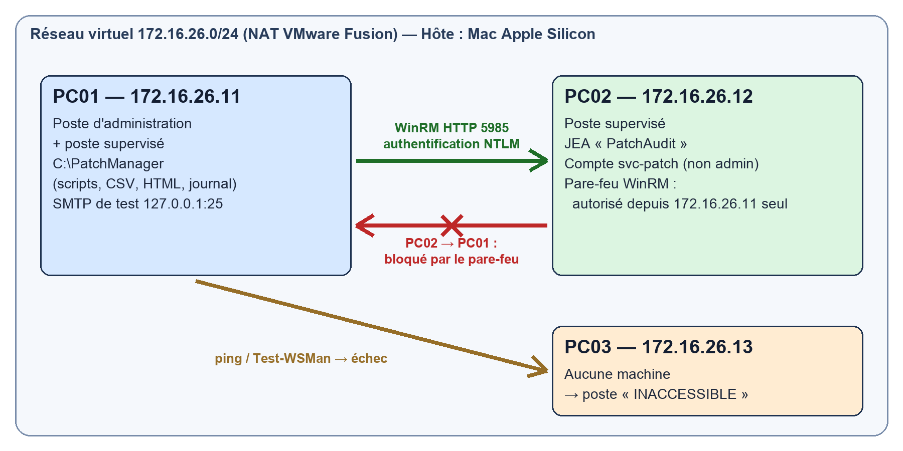{width=100%}

## 2.2 Organisation du code

Le code source complet, les fichiers de configuration, les captures et l'historique du projet sont disponibles sur le dépôt GitHub : **<https://github.com/LorisFGL/PatchManager>**. La vidéo de démonstration commentée est disponible ici : **<https://youtu.be/YpbXMxrxyQs>**.

| Fichier | Rôle | Partie |
|---|---|---|
| `Common.ps1` | Fonctions communes : lecture de la config, journal, test d'accessibilité, credential | toutes |
| `config/computers.txt` | Inventaire du parc `NOM;IP` | 1 |
| `config/required-patches.txt` | Politique : KB obligatoires | 4 |
| `config/settings.psd1` | Paramètres (chemins, compte, JEA, SMTP) — aucun secret en clair | toutes |
| `01-Test-Environment.ps1` | Lecture de `computers.txt` + disponibilité (ping + WinRM) | 1 |
| `02-Get-Inventory.ps1` | Inventaire système → `Inventory.csv` | 2 |
| `03-Get-PatchInventory.ps1` | Inventaire des correctifs → `PatchesInventory.csv`, `PatchSummary.csv` | 3 |
| `04-Test-Compliance.ps1` | Conformité → `ComplianceReport.csv` + taux | 4 |
| `05-New-Report.ps1` | Rapport de sécurité → `SecurityReport.csv` + `SecurityReport.html` | 5 |
| `06-Send-Notification.ps1` | Notification seulement en cas d'anomalie | 6 |
| `PatchManager.ps1` | Orchestrateur : enchaîne 2 → 6, journalise début/fin d'audit | 5 |
| `tools/New-PatchServiceAccount.ps1` | Création du compte de service `svc-patch` (moindre privilège) | 7 |
| `tools/Install-PatchAuditJEA.ps1` | Point de terminaison JEA `PatchAudit` | 7 |
| `tools/Start-SmtpSink.ps1` | Serveur SMTP **de test** local (labo) | 6 |

Les sorties sont écrites dans `output\`, le journal dans `logs\PatchManager.log`. Chaque script peut être lancé seul (pour la démonstration partie par partie) ou via `PatchManager.ps1`.

## 2.3 Choix techniques

- **Modularité** : un script par partie du sujet, fonctions partagées dans `Common.ps1` (lecture des fichiers, journal, test d'accessibilité). Les scripts communiquent par des fichiers CSV (`;`, UTF-8) : chaque étape est rejouable et vérifiable indépendamment.
- **Objets PowerShell** : les informations sont collectées sous forme de `[pscustomobject]`, affichées avec `Format-Table` et exportées avec `Export-Csv`.
- **Robustesse** : chaque poste est d'abord testé (`Test-Connection` puis `Test-WSMan`) ; chaque appel distant est dans un `try/catch` avec `-ErrorAction Stop`. Un poste inaccessible ou une commande qui échoue n'interrompt pas l'audit : l'erreur est **enregistrée dans l'inventaire et dans le journal**.
- **CIM plutôt que WMI** : `Get-CimInstance` (Win32_OperatingSystem, Win32_ComputerSystem, Win32_BIOS, Win32_LogicalDisk) est la méthode moderne et compatible WinRM.
- **Pas de secret en clair** : les identifiants sont stockés avec `Export-Clixml` (chiffrement **DPAPI**, lisible uniquement par le même utilisateur sur la même machine) ; le mot de passe du compte de service est généré aléatoirement et n'est jamais affiché.
- **Encodage** : scripts enregistrés en UTF-8 avec BOM pour que Windows PowerShell 5.1 affiche correctement les accents.

# 3. Partie 1 — Préparation de l'environnement

## 3.1 Connectivité entre les postes (Q1)

Après installation et configuration réseau (IP fixe, profil réseau *Privé*, règle ICMP autorisée), la connectivité est vérifiée depuis PC01 avec `Test-Connection`. PC02 répond ; PC03 n'existe pas et ne répond pas.

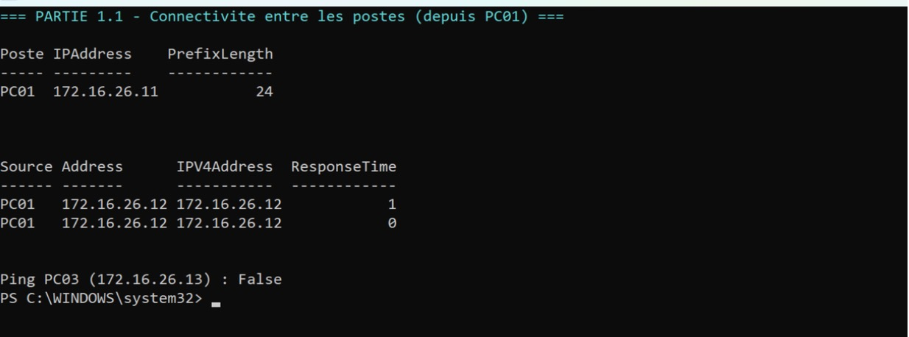{width=100%}

## 3.2 Fichier computers.txt et disponibilité (Q2–Q3)

`computers.txt` contient une ligne `NOM;IP` par poste (les lignes vides ou commençant par `#` sont ignorées). Le script `01-Test-Environment.ps1` lit ce fichier et affiche, pour chaque machine, son nom, son IP et son état, en testant **le ping et WinRM**.

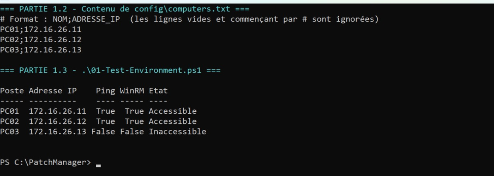{width=100%}

## 3.3 Activation de PowerShell Remoting et WinRM (Q4)

Sur chaque poste : `Enable-PSRemoting -Force` (démarre le service WinRM en automatique, crée l'écouteur HTTP et ouvre le pare-feu). Les postes n'étant pas dans un domaine, les IP du parc ont été ajoutées dans `WSMan:\localhost\Client\TrustedHosts` sur le poste d'administration (liste explicite, **jamais `*`**).

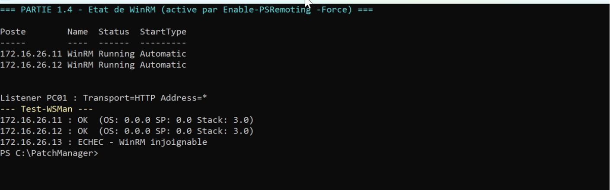{width=100%}

## 3.4 Session interactive : Enter-PSSession (Q5)

`Enter-PSSession` ouvre un shell distant : l'invite devient `[172.16.26.12]: PS>` et les commandes s'exécutent **sur PC02** (`hostname` renvoie `PC02`).

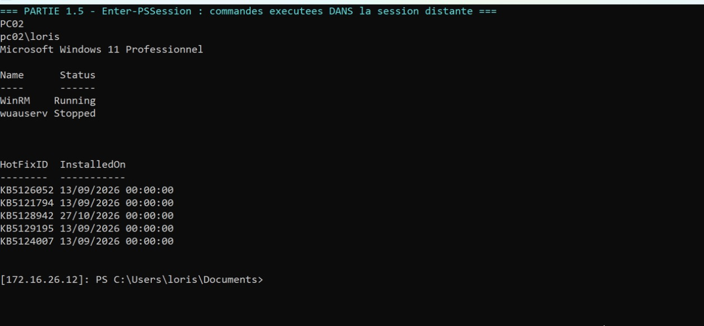{width=100%}

## 3.5 Exécution non interactive : Invoke-Command (Q6)

`Invoke-Command` exécute un bloc de script sur plusieurs postes **en parallèle** et renvoie des objets (avec la propriété `PSComputerName`). C'est le mécanisme utilisé par toute la solution.

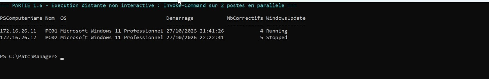{width=100%}

## 3.6 Problème rencontré : « Accès refusé » vers le clone (dépannage)

PC02 ayant été créé par **clonage** de PC01, la connexion distante échouait avec « Accès refusé », alors que les identifiants étaient corrects et fonctionnaient vers PC01.

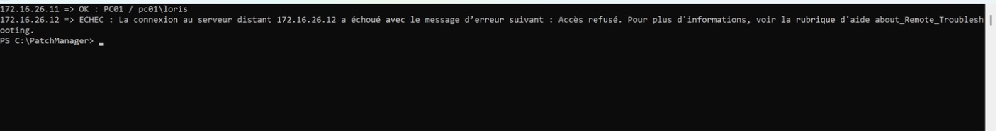{width=100%}

Le journal *Sécurité* de PC02 montrait des événements **4625** (échec d'ouverture de session) avec le code **0xC000006D** (« mauvais nom d'utilisateur ou mot de passe ») en NTLM :

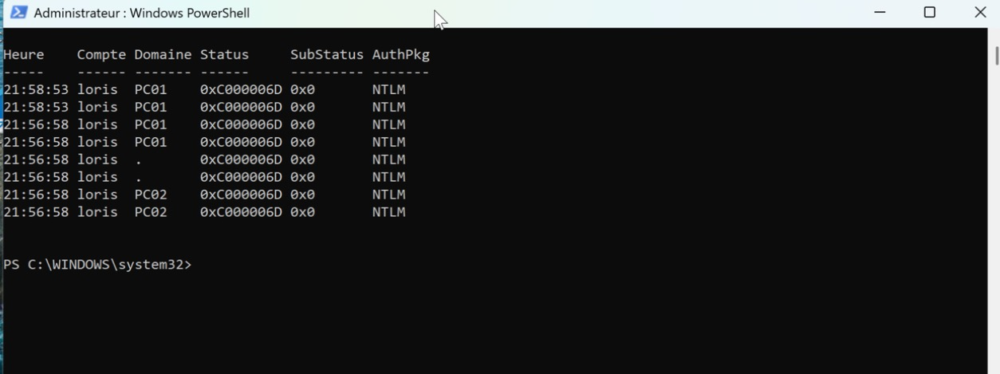{width=100%}

Diagnostic : les deux machines avaient **le même SID machine** (le compte `loris` avait le même SID `S-1-5-21-1138010104-…-1001` sur les deux postes). Avec deux comptes locaux de même SID, l'authentification NTLM entre les deux machines est rejetée.

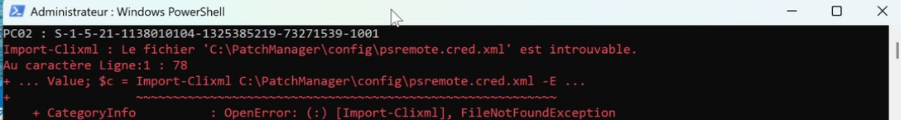{width=100%}

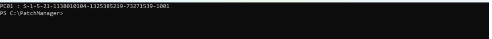{width=100%}

Correction : généralisation de PC02 avec `sysprep /generalize /oobe /reboot`, qui régénère le SID machine, puis reconfiguration (nom, IP, WinRM). Après correction, les deux postes répondent avec des SID différents :

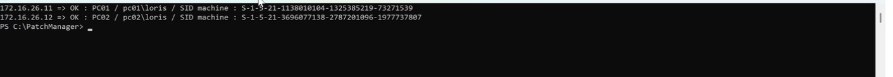{width=100%}

> **Leçon** : on ne déploie jamais un clone Windows sans Sysprep ; c'est la procédure normale de préparation d'une image (master).

## 3.7 Réponses aux questions de la partie 1

**Quel est le rôle de WinRM dans PowerShell Remoting ?**
WinRM (*Windows Remote Management*) est le service Windows qui implémente le protocole standard **WS-Management** (SOAP sur HTTP/HTTPS). PowerShell Remoting s'appuie dessus comme couche de transport : le client envoie la commande à l'écouteur WinRM du poste distant, qui authentifie l'utilisateur, lance un processus hôte (`wsmprovhost.exe`) exécutant la commande, puis renvoie les résultats sous forme d'objets sérialisés (XML).

**Quelle commande permet d'activer PowerShell Remoting ?**
`Enable-PSRemoting -Force` (en administrateur). Elle démarre et passe en automatique le service WinRM, crée l'écouteur HTTP, enregistre les configurations de session et crée les règles de pare-feu. Alternative historique : `winrm quickconfig`.

**Quels ports réseau sont utilisés par WinRM ?**
**TCP 5985** en HTTP et **TCP 5986** en HTTPS. En HTTP, le contenu est tout de même chiffré au niveau message après authentification Kerberos ou NTLM (`AllowUnencrypted = false`, vérifié en partie 7).

**Pourquoi le pare-feu Windows peut-il empêcher une connexion PowerShell distante ?**
La connexion nécessite une règle entrante autorisant TCP 5985. Cette règle peut être désactivée, limitée à certains profils réseau (par défaut, en profil **Public** elle n'accepte que le sous-réseau local, et `Enable-PSRemoting` refuse de s'exécuter si une interface est en Public), ou restreinte à certaines adresses sources. Dans tous ces cas, la connexion échoue même si le service tourne.

**Quelle différence entre Test-Connection et Test-WSMan ?**
`Test-Connection` envoie un **ping ICMP** : il vérifie seulement que la machine est joignable au niveau réseau (couche 3). `Test-WSMan` interroge le **service WinRM** sur le port 5985 : il vérifie que l'administration distante est réellement possible (couche application). Un poste peut répondre au ping avec WinRM arrêté ou bloqué, et inversement bloquer l'ICMP tout en acceptant WinRM.

**Pourquoi vérifier l'accessibilité d'une machine avant une commande distante ?**
Pour éviter les longs délais d'expiration qui ralentissent l'audit de tout le parc, ne pas interrompre le traitement, et **classer précisément** le poste (« Ping sans réponse » ou « WinRM inaccessible ») avec une cause exploitable par l'administrateur dans le rapport et le journal.

**Quels problèmes de sécurité si PowerShell Remoting est activé sans restriction ?**
Un attaquant disposant d'identifiants peut exécuter n'importe quelle commande à distance avec des droits administrateur (déploiement de rançongiciel, **mouvement latéral** de poste en poste), surtout si l'écoute est ouverte à tout le réseau ; `TrustedHosts = *` désactive la vérification de l'identité des serveurs ; des méthodes faibles (Basic, trafic non chiffré) exposent les mots de passe ; un compte d'administration unique utilisé partout devient une cible de choix ; et sans journalisation, les actions ne sont pas traçables. Ces risques sont traités en partie 7.

# 4. Partie 2 — Inventaire du parc

`02-Get-Inventory.ps1` lit `computers.txt`, teste chaque poste puis, pour les postes accessibles, exécute à distance un bloc qui collecte : nom, modèle, version du BIOS, version et édition de Windows, architecture, dernier démarrage, RAM, espace libre du disque système, **date de la dernière mise à jour, nombre de mises à jour installées et état du service Windows Update (`wuauserv`)**. Les données sont renvoyées sous forme d'objets, affichées en tableau et exportées dans `output\Inventory.csv`.

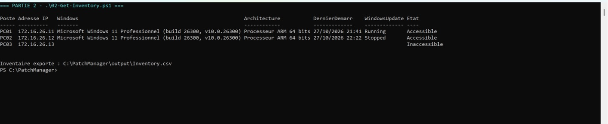{width=100%}

Le détail de `Inventory.csv` montre l'ensemble des champs, et pour PC03 **l'erreur rencontrée enregistrée dans l'inventaire** (« Ping sans réponse »), sans que l'exécution ait été interrompue :

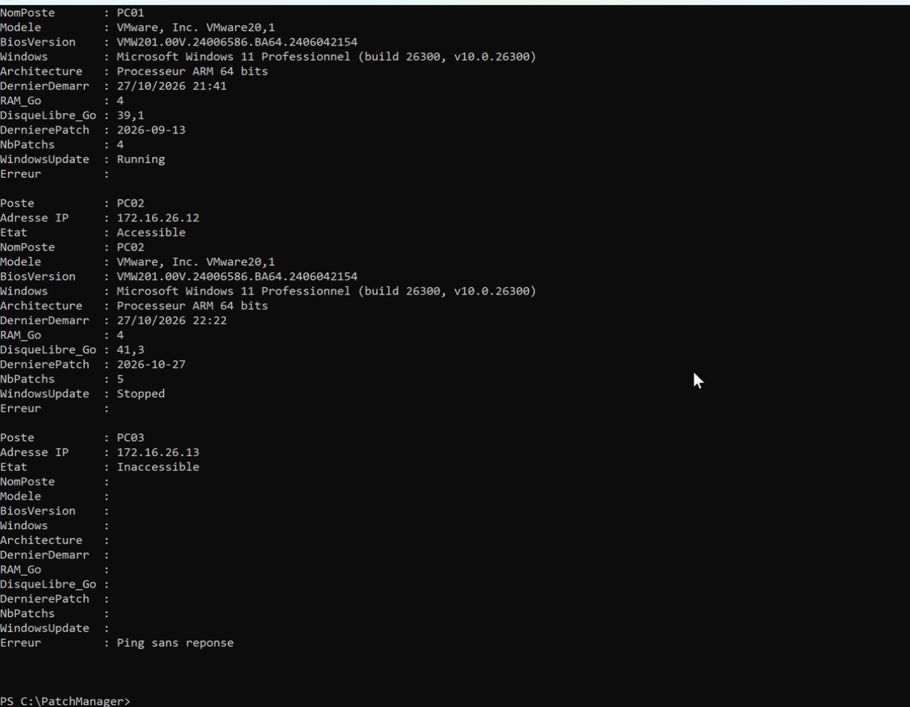{width=100%}

Remarque : les VM étant sous VMware sur Apple Silicon, le modèle remonte « VMware20,1 » et l'architecture « Processeur ARM 64 bits ».

# 5. Partie 3 — Inventaire des correctifs

`03-Get-PatchInventory.ps1` affiche d'abord les correctifs de la machine locale (`Get-HotFix` : **KB, description, date d'installation, compte installateur**), puis interroge chaque poste accessible à distance et ignore proprement les postes inaccessibles.

Le champ *InstalledBy* est vide sur ces postes : Windows ne le renseigne pas pour les mises à jour cumulatives installées par le service Windows Update (« lorsque l'information est disponible », comme le prévoit le sujet).

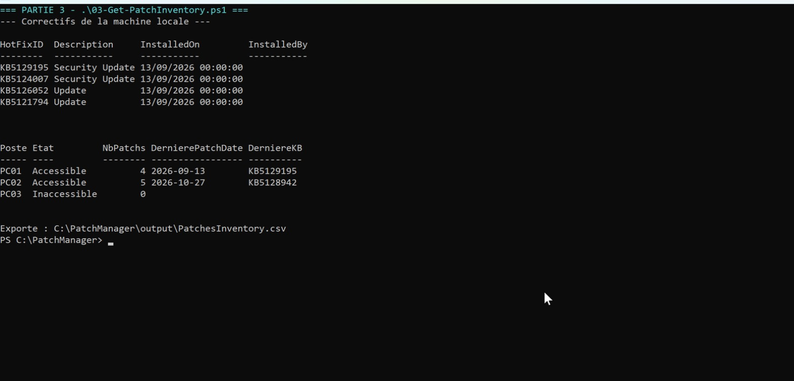{width=100%}

Tous les résultats sont regroupés dans `PatchesInventory.csv`, **triés par poste puis par date d'installation décroissante** ; `PatchSummary.csv` donne pour chaque poste le **nombre total de correctifs, la date du plus récent et la KB du dernier installé** :

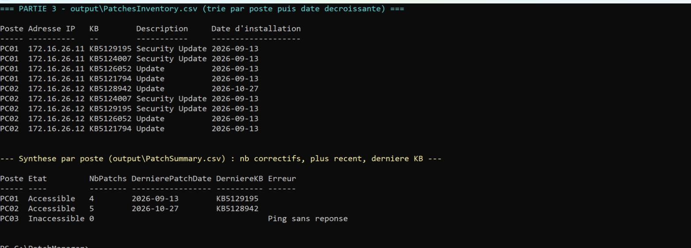{width=100%}

On constate que **PC02 possède la mise à jour cumulative KB5128942 (27/10/2026) que PC01 n'a pas** : PC02 l'a reçue lors de sa réinstallation (phase OOBE après Sysprep), tandis que sur PC01 l'installation lancée depuis Windows Update n'était pas encore terminée au moment de l'audit. Ce décalage réel entre deux postes est exactement le type de situation que le Patch Management doit détecter.

# 6. Partie 4 — Contrôle de conformité

`config\required-patches.txt` définit la politique minimale : une KB obligatoire par ligne (les commentaires `#` documentent la date de mise à jour de la politique). Elle contient les deux mises à jour de sécurité de septembre et la cumulative d'octobre.

`04-Test-Compliance.ps1` compare, pour chaque poste accessible, les KB installées aux KB requises (comparaison insensible à la casse) et attribue un état :

- **CONFORME** : toutes les KB requises sont installées ;
- **NON CONFORME** : au moins une KB manque — la liste précise est affichée ;
- **INACCESSIBLE** : le poste n'a pas pu être contrôlé.

La date et l'heure du contrôle sont ajoutées, les résultats sont enregistrés dans `ComplianceReport.csv`, et le **taux global de conformité** est calculé **sans les postes inaccessibles** : 1 conforme sur 2 contrôlés = **50 %**.

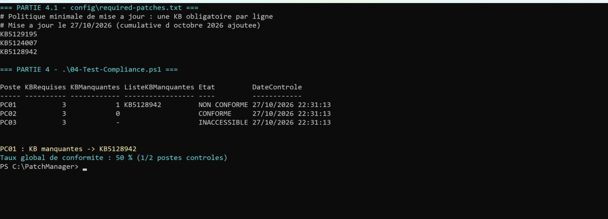{width=100%}

**Pourquoi la politique de conformité doit-elle être régulièrement mise à jour ?**
Parce que de nouvelles vulnérabilités sont découvertes en permanence et que Microsoft publie des correctifs chaque mois (*Patch Tuesday*, voire hors cycle pour les failles critiques exploitées). Les mises à jour cumulatives **remplacent** les précédentes (une KB requise peut devenir obsolète), certaines versions de Windows arrivent en fin de support, et le contexte de menace évolue. Une politique figée donnerait un **faux sentiment de sécurité** : un poste « conforme » à une liste périmée peut rester vulnérable. Ici, la politique a d'ailleurs été mise à jour le 27/10 pour inclure la cumulative d'octobre, ce qui a rendu PC01 non conforme.

# 7. Partie 5 — Rapport de sécurité

`05-New-Report.ps1` fusionne l'inventaire et la conformité et produit `SecurityReport.csv` et `SecurityReport.html`, avec pour chaque poste : nom, IP, accessibilité, version de Windows, dernier démarrage, état de Windows Update, nombre de KB requises et manquantes, liste des KB manquantes, état de conformité, date/heure du contrôle. Il calcule la **synthèse globale** (postes totaux, accessibles, inaccessibles, conformes, non conformes, total de KB manquantes, taux de conformité).

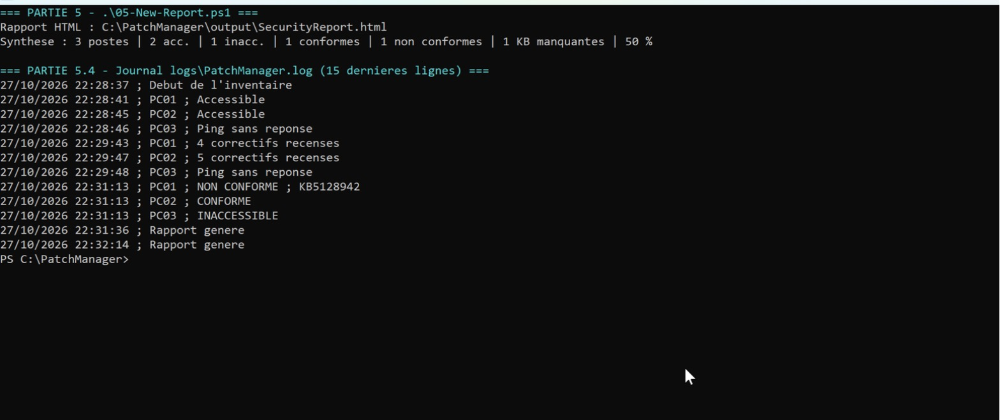{width=100%}

La version HTML comporte la synthèse, une section **« Postes nécessitant une intervention »** avec l'action à mener, et le détail coloré par état (vert = conforme, rouge = non conforme, orange = inaccessible). Les valeurs sont encodées (`HtmlEncode`) pour éviter toute injection HTML.

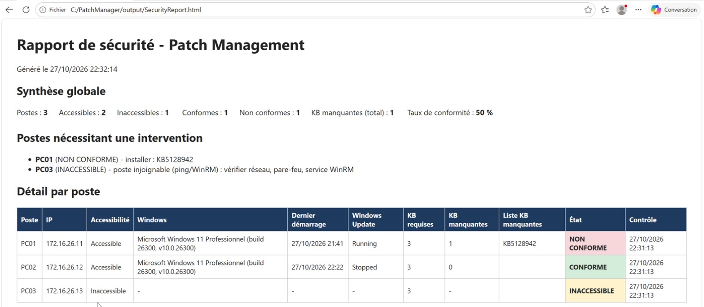{width=100%}

Le programme conserve l'historique de ses exécutions dans `logs\PatchManager.log` au format demandé (`date heure ; poste ; événement`). Exécution complète via l'orchestrateur `PatchManager.ps1` :

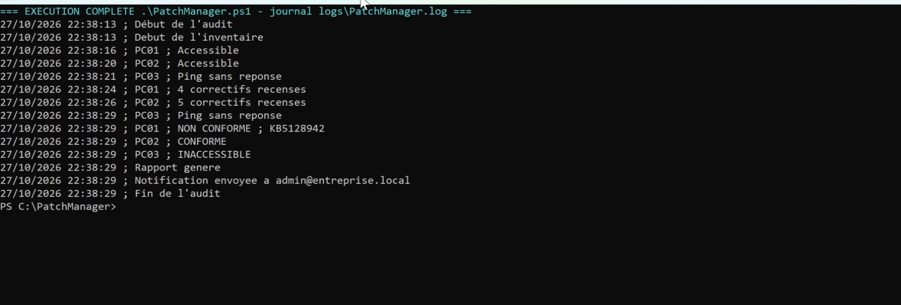{width=100%}

Deux bugs ont été corrigés pendant les tests du script de rapport : une fonction nommée `H` entrait en conflit avec l'alias PowerShell `H` (`Get-History`), et `Measure-Object` était appelé avec une syntaxe invalide pour la somme des KB manquantes.

# 8. Partie 6 — Notification

`06-Send-Notification.ps1` lit le rapport et **n'envoie un message que si au moins un poste est NON CONFORME ou INACCESSIBLE** ; sinon il se termine en le journalisant. Le message reprend le format demandé (objet `[PATCH MANAGEMENT] Anomalies détectées`, date, nombre de postes, détail par poste avec les KB manquantes) et **joint le rapport HTML**. Les paramètres SMTP sont dans `settings.psd1` ; un éventuel mot de passe de messagerie est lu depuis un fichier chiffré DPAPI (`smtp.cred.xml`), jamais écrit dans le script.

Pour le laboratoire (pas de serveur de messagerie d'entreprise), un **serveur SMTP de test** minimal (`tools\Start-SmtpSink.ps1`) écoute sur `127.0.0.1:25` et enregistre les messages reçus en fichiers `.eml` sans rien relayer.

**Cas d'échec** (serveur arrêté) : le script ne plante pas et journalise `ERREUR ; Notification non envoyée` :

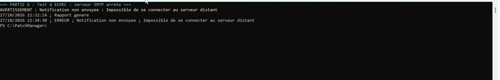{width=100%}

**Cas nominal** : le serveur de test reçoit le message, et le journal trace `Notification envoyée à admin@entreprise.local` :

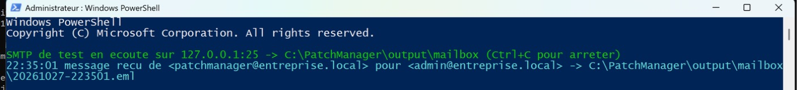{width=100%}

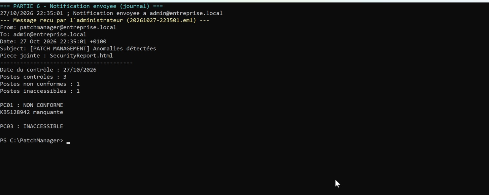{width=100%}

**Quels sont les inconvénients de cette solution ?**

- `Send-MailMessage` est **déclaré obsolète** par Microsoft (ne garantit pas une connexion sécurisée) ;
- dépendance à un serveur SMTP joignable et à un compte de messagerie dont il faut protéger les identifiants (le fichier DPAPI est lié à un utilisateur et une machine, ce qui complique l'automatisation) ;
- le rapport joint contient la **liste des postes vulnérables** : s'il est intercepté ou transféré, il sert de carte à un attaquant (SMTP pas toujours chiffré de bout en bout) ;
- aucun accusé de lecture ni suivi : le message peut finir en spam ou ne pas être lu ;
- pas de déduplication ni d'escalade : un mail à chaque exécution tant que l'anomalie persiste (lassitude des alertes) ;
- si le poste d'administration est en panne, aucune alerte n'est émise.

**Quelles alternatives modernes ?**

- **Microsoft Graph API** (envoi via Exchange Online avec une application enregistrée et OAuth2 / certificat, sans mot de passe) ;
- **webhooks** vers Microsoft Teams ou Slack ;
- outils de **supervision** (Zabbix, Nagios/Centreon, PRTG, Prometheus + Alertmanager) qui gèrent seuils, escalade et historique ;
- **SIEM** (Microsoft Sentinel, Wazuh, Splunk) : centralisation des journaux et alertes corrélées ;
- création automatique de **tickets** (GLPI, ServiceNow, Jira) ;
- et surtout des solutions de patch management dédiées : **WSUS**, **Microsoft Intune / Windows Update for Business**, **Configuration Manager (MECM)**, **Azure Update Manager**, qui intègrent conformité, déploiement et rapports ;
- secrets stockés dans un coffre (**SecretManagement**, Azure Key Vault) plutôt que dans un fichier.

# 9. Partie 7 — Sécurisation de la solution

## 9.1 Risques liés à PowerShell Remoting / WinRM (Q1)

| Risque | Conséquence |
|---|---|
| Compte d'administration commun à tous les postes | Sa compromission donne le contrôle de tout le parc |
| Poste d'administration compromis | Pivot vers tous les postes (mouvement latéral) |
| WinRM ouvert à tout le réseau | N'importe quel poste compromis peut tenter de s'y connecter |
| Authentification faible (Basic, NTLM), HTTP | Vol ou relais d'identifiants, interception |
| `TrustedHosts = *` | Aucune vérification de l'identité du serveur (usurpation) |
| Droits excessifs pendant la session | Exécution de n'importe quelle commande |
| Fichiers produits lisibles | Fuite de l'inventaire et des vulnérabilités du parc |
| Journaux modifiables/supprimables | Perte de traçabilité, effacement des traces |

## 9.2 Qui peut ouvrir une session distante ? (Q2)

La configuration de session par défaut `Microsoft.PowerShell` n'autorise que le groupe **Administrateurs** et le groupe **Utilisateurs de gestion à distance** (vide par défaut) ; `INTERACTIF` concerne les sessions locales. Sur les deux postes, seuls `Administrateur` (désactivé par défaut) et les comptes `loris`/`loris2` peuvent donc s'y connecter.

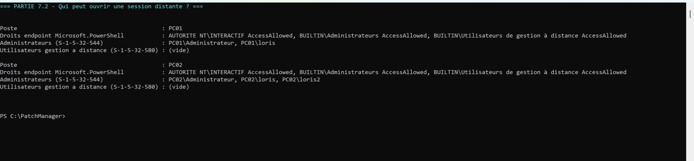{width=100%}

## 9.3 Moindre privilège : compte de service dédié (Q3)

`tools\New-PatchServiceAccount.ps1` crée sur chaque poste le compte **`svc-patch`** :

- **non administrateur**, seulement membre de *Utilisateurs de gestion à distance* (`S-1-5-32-580`) ;
- mot de passe **aléatoire de 24 caractères** (générateur cryptographique), jamais affiché, stocké uniquement chiffré DPAPI dans `config\svcpatch.cred.xml`.

Test : `svc-patch` se connecte mais n'est pas administrateur ; la création d'un compte est **refusée**. On constate aussi que, sans privilèges, même `Get-HotFix` est refusé : d'où l'intérêt de JEA (9.7), qui exécute uniquement les fonctions autorisées sous un compte virtuel privilégié.

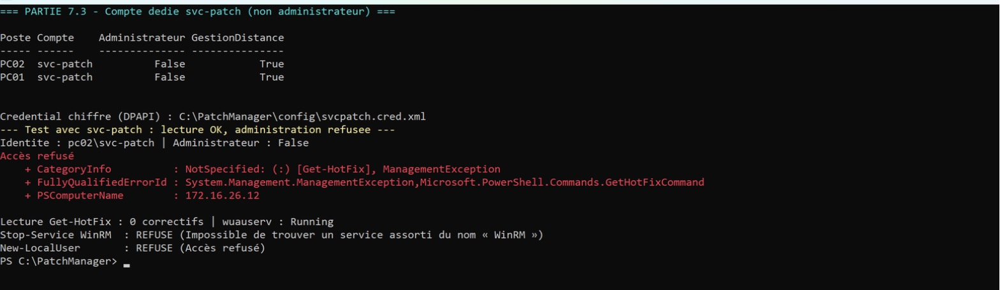{width=100%}

La solution est ensuite configurée pour utiliser ce compte via JEA (`settings.psd1`). L'audit complet donne les mêmes résultats qu'avec un compte administrateur :

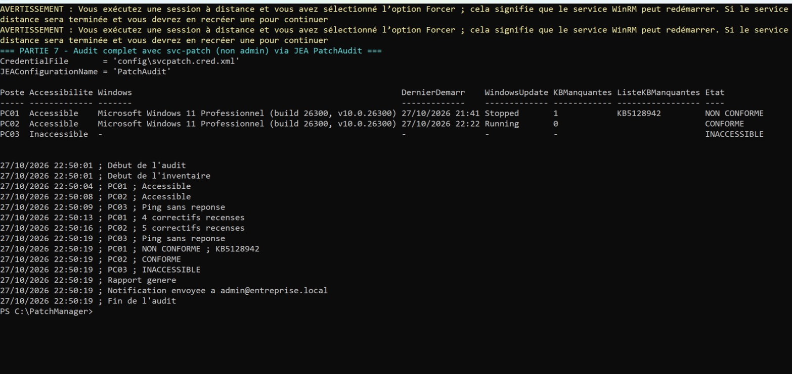{width=100%}

Le credential d'administration utilisé pour l'installation est lui aussi stocké chiffré (DPAPI) — le mot de passe n'apparaît jamais en clair :

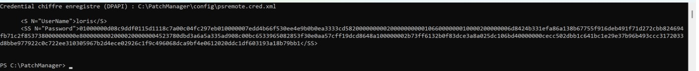{width=100%}

## 9.4 Protection des fichiers produits (Q4)

Par héritage de `C:\`, tous les *Utilisateurs authentifiés* pouvaient lire et modifier `C:\PatchManager\output`. L'héritage a été coupé (`icacls /inheritance:r`) sur `config`, `output` et `logs` : seuls **SYSTEM**, **Administrateurs** et le compte d'exploitation conservent un accès.

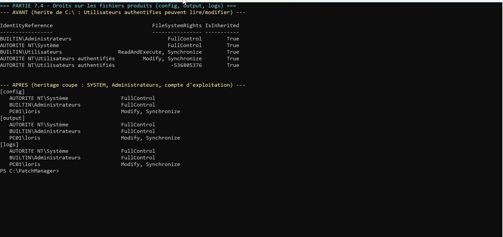{width=100%}

Les fichiers sensibles (`*.cred.xml`, `output/`, `logs/`) sont aussi exclus du dépôt Git (`.gitignore`).

## 9.5 Pare-feu WinRM (Q5)

Sur un poste en profil *Privé*, la règle active est `WINRM-HTTP-In-TCP-NoScope`, qui accepte **toutes** les adresses (`Any`). Elle a été restreinte sur les deux postes à l'**IP du poste d'administration** `172.16.26.11`. Vérification : PC01 → PC02 fonctionne, PC02 → PC01 est désormais **bloqué**.

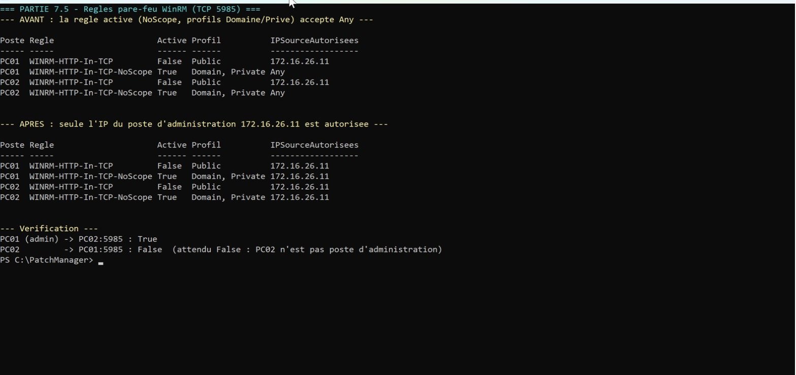{width=100%}

*Erreur rencontrée* : une première tentative avait modifié la règle `WINRM-HTTP-In-TCP` (profil Public, inactive) au lieu de la règle réellement active — la vérification (PC02 → PC01 encore possible) a permis de le détecter. Il faut toujours **vérifier l'effet** d'une mesure de sécurité, pas seulement l'appliquer.

## 9.6 Mode d'authentification ; quand préférer Kerberos (Q6)

Côté service : *Basic*, *CredSSP*, *Certificate* désactivés, `AllowUnencrypted = false`. Le journal Sécurité de PC02 (événement **4624**, ouverture de session réseau de type 3) montre le protocole **réellement utilisé : NTLM**, car les postes ne sont pas membres d'un domaine Active Directory (*Negotiate* tente Kerberos puis se replie sur NTLM).

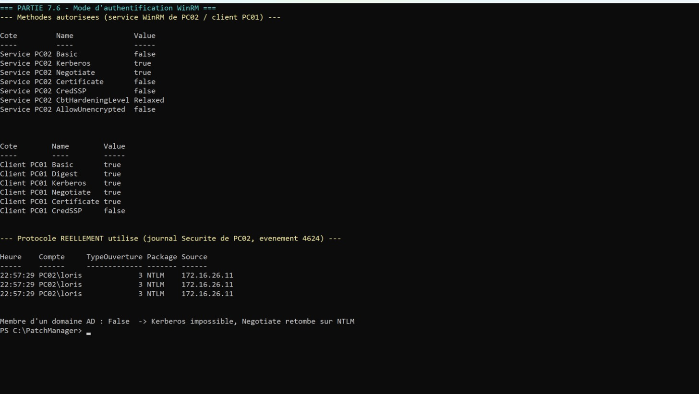{width=100%}

Le client WinRM de PC01 autorisait encore *Basic* et *Digest* : ils ont été désactivés.

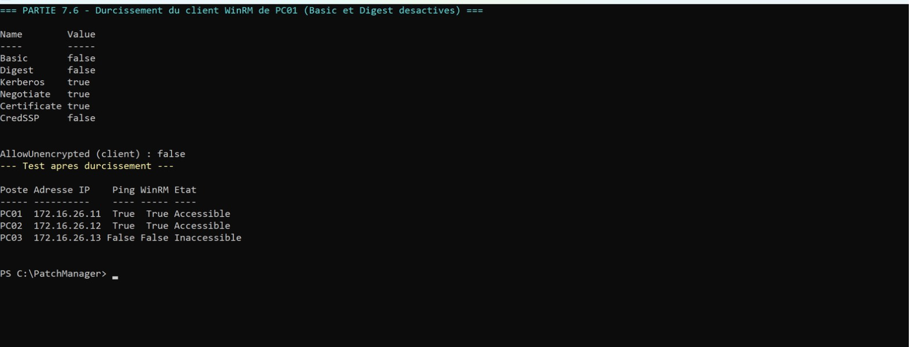{width=100%}

**Kerberos est préférable** dès que les postes sont dans un **domaine Active Directory** : authentification **mutuelle** (le client vérifie aussi l'identité du serveur, ce qui supprime le besoin de `TrustedHosts`), mot de passe jamais transmis (tickets limités dans le temps), protection contre le relais NTLM et le *pass-the-hash*, délégation contrôlée. En groupe de travail, comme ici, il faut compenser par **WinRM en HTTPS (5986)** avec un certificat qui authentifie le serveur, une liste `TrustedHosts` explicite et des mots de passe locaux uniques (LAPS).

## 9.7 Just Enough Administration (Q7)

**Principe** : JEA crée un **point de terminaison PowerShell restreint**. Un fichier de capacités de rôle (`.psrc`) liste précisément les commandes visibles ; un fichier de configuration de session (`.pssc`) associe des utilisateurs à ce rôle, impose le mode **`RestrictedRemoteServer`** (*NoLanguage* : pas de script arbitraire), exécute les commandes sous un **compte virtuel** temporaire et **transcrit** chaque session. L'utilisateur peut ainsi effectuer une tâche d'administration précise **sans être administrateur**.

**Mise en œuvre** : `tools\Install-PatchAuditJEA.ps1` installe sur les deux postes le point de terminaison **`PatchAudit`**, réservé à `svc-patch`, qui n'expose que deux fonctions de **lecture** : `Get-PMInventoryData` et `Get-PMHotFix`. Les scripts 02 et 03 les appellent automatiquement quand `JEAConfigurationName` est défini dans `settings.psd1`. Démonstration : seules quelques commandes sont visibles, la lecture des correctifs fonctionne, et `Stop-Service`, `Get-Process` ou toute expression (`$x = 1 + 1`) sont **refusés**. Les transcriptions sont écrites dans `C:\ProgramData\JEA\Transcripts`.

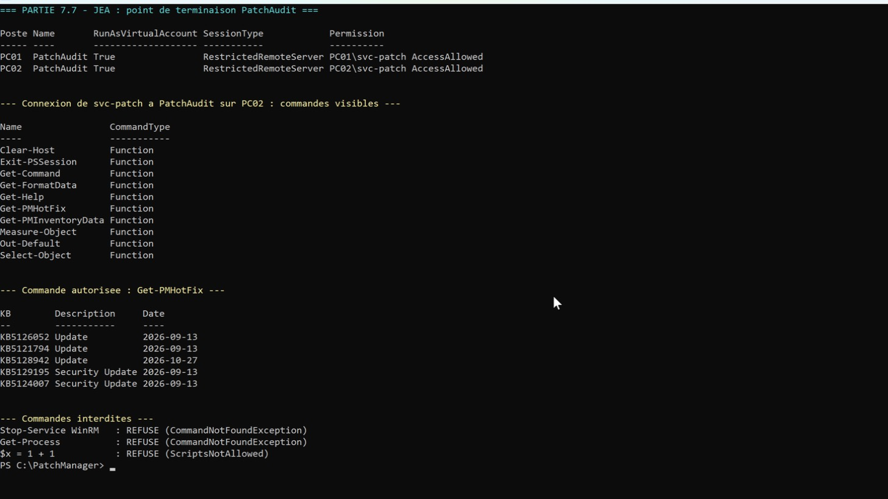{width=100%}

## 9.8 Stratégie de conservation des rapports et journaux (Q8)

| Objectif | Mesures proposées |
|---|---|
| **Éviter la modification non autorisée** | ACL strictes (fait, 9.4) ; écriture du journal en ajout seul par le compte d'exploitation ; empreinte **SHA-256** (`Get-FileHash`) de chaque rapport consignée dans un manifeste ; signature éventuelle des rapports ; envoi des événements vers un **collecteur central / SIEM** (Windows Event Forwarding, syslog) où le poste audité ne peut pas les modifier. |
| **Éviter la suppression** | Copie quotidienne vers un partage ou stockage **en lecture seule / WORM** (immuable) ; sauvegarde 3-2-1 dont une copie hors ligne ; journal d'audit des accès aux dossiers (stratégie d'audit des objets). |
| **Éviter l'exposition d'informations sensibles** | Accès aux rapports limité à l'équipe sécurité (besoin d'en connaître) ; chiffrement au repos (**BitLocker** ou `Protect-CmsMessage` pour les archives) ; pas de rapport détaillé par e-mail non chiffré ; secrets stockés uniquement chiffrés (DPAPI) et hors dépôt Git ; durée de conservation définie (par exemple 90 jours en ligne, 1 an archivé chiffré) puis suppression sécurisée. |

En complément, la **journalisation PowerShell** (*Script Block Logging* et *Transcription* par stratégie de groupe) garde une trace de toutes les commandes exécutées sur les postes.

# 10. Tests réalisés et résultats

| Test | Résultat attendu | Résultat obtenu |
|---|---|---|
| Poste accessible (PC01, PC02) | Inventaire et correctifs collectés | ✅ |
| Poste inexistant (PC03) | Classé *Inaccessible*, erreur enregistrée, audit non interrompu | ✅ « Ping sans réponse » |
| KB manquante (PC01) | *NON CONFORME* + liste des KB | ✅ KB5128942 |
| Toutes KB présentes (PC02) | *CONFORME* | ✅ |
| Taux de conformité | Hors inaccessibles | ✅ 50 % (1/2) |
| Rapport CSV + HTML | Synthèse + section intervention | ✅ |
| Journal | Début/fin d'audit, état par poste | ✅ |
| Notification avec anomalie | Envoi + pièce jointe + journal | ✅ |
| Échec SMTP | `ERREUR ; Notification non envoyée` | ✅ |
| Compte non admin via JEA | Audit identique, commandes d'administration refusées | ✅ |
| Pare-feu restreint | Seul PC01 peut joindre WinRM | ✅ (après correction) |

**Synthèse du parc au 27/10/2026** : 3 postes, 2 accessibles, 1 inaccessible, 1 conforme, 1 non conforme, 1 KB manquante, **taux de conformité 50 %**. Action à mener : terminer l'installation de KB5128942 sur PC01 (puis redémarrer) et vérifier PC03.

# 11. Limites et améliorations possibles

- `Get-HotFix` (classe `Win32_QuickFixEngineering`) ne voit que les mises à jour du système (CBS) : pas les mises à jour Defender, pilotes ou applications. L'API COM `Microsoft.Update.Session` ou le module `PSWindowsUpdate` permettraient en plus de lister les mises à jour **disponibles non installées** et de détecter un redémarrage en attente.
- Le service `wuauserv` est à démarrage *à la demande* : son état (*Running/Stopped*) varie selon l'activité ; vérifier aussi son type de démarrage (*Disabled* = vrai problème) serait plus pertinent.
- Les postes sont traités séquentiellement ; pour un grand parc, `Invoke-Command -ComputerName <liste> -ThrottleLimit` ou `ForEach-Object -Parallel` (PowerShell 7) réduirait fortement la durée.
- La solution ne corrige pas : une étape de remédiation (installation des KB manquantes) pourrait être ajoutée, idéalement via WSUS/Intune.
- WinRM en HTTPS avec certificats et planification de l'audit (tâche planifiée sous le compte de service) seraient les prochaines étapes vers une utilisation en production.

# 12. Conclusion

La solution réalisée couvre toute la chaîne demandée : lecture de l'inventaire, test de disponibilité, administration distante par WinRM, inventaire système et des correctifs, contrôle de conformité par rapport à une politique, rapport CSV/HTML avec synthèse et postes à traiter, journalisation, notification conditionnelle et sécurisation (compte dédié non administrateur, JEA, pare-feu restreint, ACL, secrets chiffrés). Elle a été testée sur un parc réel de deux postes Windows 11 plus un poste inaccessible simulé.

Le projet a aussi montré l'importance des bonnes pratiques d'exploitation : un clone non généralisé (SID dupliqué) bloque l'authentification, et une mesure de sécurité doit toujours être **vérifiée** après application.

# Annexe — Utilisation

```powershell
# Poste d'administration (PowerShell en administrateur), dans C:\PatchManager
Set-ExecutionPolicy -Scope Process Bypass

# 1. Credential d'installation (chiffré DPAPI)
Get-Credential | Export-Clixml .\config\psremote.cred.xml

# 2. Sécurisation (partie 7) : compte de service + JEA
.\tools\New-PatchServiceAccount.ps1
.\tools\Install-PatchAuditJEA.ps1

# 3. Audit complet (ou chaque script 01 à 06 séparément)
.\PatchManager.ps1
```
